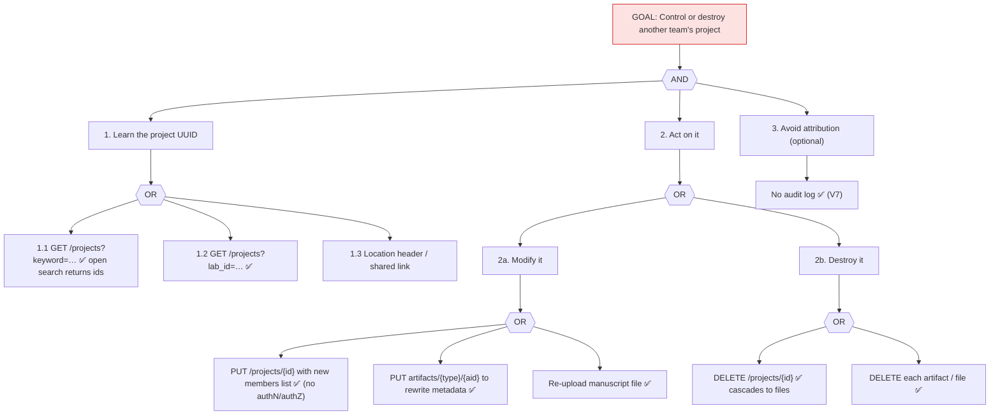
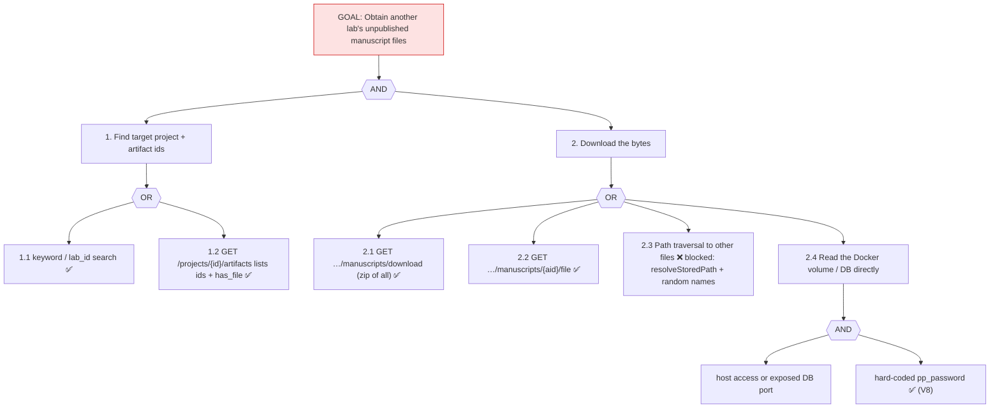
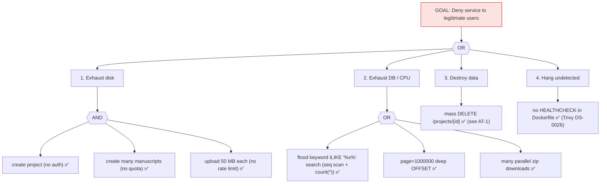
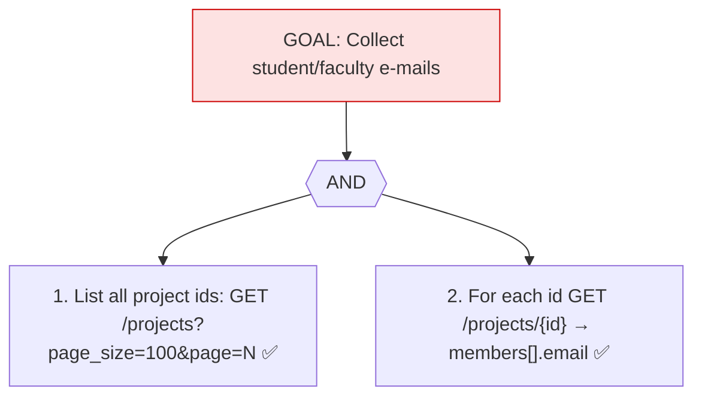
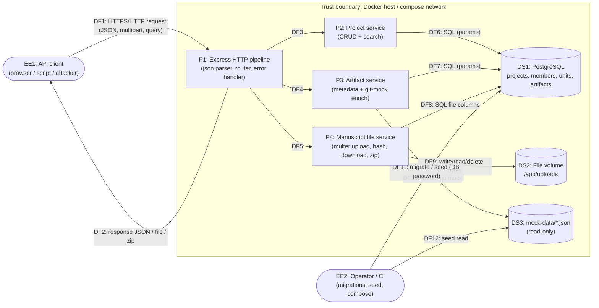

# Security Analysis — PA2 Naive Baseline

**Project Portal · Domain 1 · Project Artifact & Repository Indexer (PAI)** · CS 763 Project Assignment 2
**Author:** Alexa Stein · **Analyzed build:** `functional-codebase/` on branch `pa2` @ `8ee0608` · **Date:** 2026-11-16

---

## AI Deliverable Metadata Block

| Field | Value |
|---|---|
| Conceptual AI contribution | **[__%] AI Generated / [__%] Human Authored** ← set after your edits (an unedited Claude draft ≈ 80% AI) |
| AI tool | Claude (claude.ai chat, Claude Opus 5.5) — conversational assistant used for threat-modeling support |
| What the AI did | Read the generated source and pipeline logs; drafted requirements, abuse cases, attack trees, attack-surface table, DFD, STRIDE matrix and mitigation plan |
| What the human did | _<e.g. checked every DFD element against the code, removed/added threats, re-ranked risks, rewrote sections in own words>_ |
| Design-aid prompts | 1) "Please complete project assignment 2 … give me detailed instructions" 2) "pushed" |
| Chat share link | _<paste claude.ai share link>_ |

---

## 1. System overview (what the agent actually built)

| Item | Implementation |
|---|---|
| Runtime | Node.js 22, Express 5, TypeScript; one container `api` (port 3000) |
| Data store | PostgreSQL 16 container `db` (`pg` driver, raw parameterized SQL) — tables `projects`, `project_members`, `academic_units`, `project_academic_units`, `artifacts`, `manuscripts`, `videos`, `repositories` |
| File store | Docker volume `manuscript_files` mounted at `/app/uploads` (`FILE_STORAGE_DIR`), files saved as `<project>/<artifact>/<random-uuid>` |
| Static mock data | `mock-data/*.json` (labs, programs, courses, users, seed projects, git-host repos) — read at seed time and by `git-mock.ts` |
| Identity | **none** — no users, sessions, tokens or roles at request time |
| Endpoints | 7 route groups / 15 operations from the master spec + `GET /health` |

**Assets to protect (ranked)**
1. **Integrity of the project catalog** — the service is the "global master source of truth" for projects.
2. **Manuscript files** — unpublished research may be confidential; file hash is the integrity anchor.
3. **Member PII** — names, e-mails, academic roles of students/faculty.
4. **Availability** of search and downloads; disk space of the file volume.
5. **DB credentials / host** — compromise gives everything above.

**Actors:** Anonymous internet user · Project member (student) · Faculty / advisor (project owner) · Curator / Admin (portal operator) · Operator with Docker host access.

---

## 2. Security requirements (defensive baseline)

Each requirement has an ID that the mitigations (§7) and PA3 prompt architecture will reference.

| ID | Category | Requirement |
|---|---|---|
| **SR-1** | Authentication | Every `/api/v1/**` request except `GET` on **public** catalog data must carry a valid bearer JWT signed with an **asymmetric** key (RS256 or EdDSA), verified locally against a pinned public key; reject `alg=none`, HS* algorithms, expired (`exp`), not-yet-valid (`nbf`) and wrong `iss`/`aud` tokens with `401`. |
| **SR-2** | Authorization (RBAC) | Roles `ADMIN`, `CURATOR`, `FACULTY`, `STUDENT`, `VIEWER`. Only authenticated users may create projects; only `ADMIN` may delete any project. |
| **SR-3** | Authorization (row level) | Every read/write on a project, artifact or file must check that the caller is a member of **that** project (or `ADMIN`/curator of one of its academic units). The check must be part of the DB query (`WHERE … AND EXISTS(member = :caller)`), not a separate lookup. Unknown **or forbidden** IDs both return `404` to avoid ID enumeration. |
| **SR-4** | Authorization (privileged fields) | Only a project's `faculty`/`advisor` member (or `ADMIN`) may change the member list or roles; a project must always keep ≥ 1 faculty/advisor; a caller cannot grant themselves a higher role. |
| **SR-5** | Input validation | All bodies, params and queries validated against strict schemas (types, lengths, enums, UUID format, http(s) URLs, unknown fields rejected). Keep the existing Zod schemas and add `.strict()`. |
| **SR-6** | File upload | Accept only PDF (`.pdf` extension **and** `%PDF-` magic bytes); max size configurable (default 25 MB); store under server-generated names outside any web root; always download with `Content-Disposition: attachment`, `Content-Type: application/pdf`, `nosniff`; recompute SHA-256 on download and refuse on mismatch. |
| **SR-7** | Resource limits | Rate limit per caller/IP (e.g. 100 req/min, 10 uploads/min); per-project quota (e.g. 20 manuscripts / 200 MB); cap `page` × `page_size` (e.g. offset ≤ 10 000); use indexed full-text search instead of leading-wildcard `ILIKE`; statement timeout on DB queries; cap zip size/entries. |
| **SR-8** | Integrity / concurrency | `PUT` on projects and artifacts requires the current `revision_version` (`If-Match` or body field); mismatch → `409 Conflict`. Artifacts get their own `revision_version`. |
| **SR-9** | Privacy | Member e-mails are returned only to authenticated members of that project or admins; public/anonymous views show name and role only. Search results never include member PII. |
| **SR-10** | Audit | Append-only `audit_log` table: timestamp, caller id (`sub`), action, object type/id, old/new revision, request id, source IP. Log all create/update/delete/upload/download-of-unpublished events; never log tokens or file contents. |
| **SR-11** | Error handling | Generic error bodies (already done); no stack traces; consistent `404` for unknown and forbidden objects. |
| **SR-12** | Transport & headers | TLS terminated in front of the API in any non-local deployment; `helmet` defaults; `x-powered-by` disabled; CORS deny-by-default with an explicit allow-list. |
| **SR-13** | Secrets & config | No credentials in Git: DB password and JWT public key path from environment/Docker secrets; least-privileged DB role (no DDL at runtime — migrations run as a separate role). |
| **SR-14** | Container hardening | Non-root user (already done), `read_only` root FS + writable upload volume only, `no-new-privileges`, `HEALTHCHECK`, API published on `127.0.0.1` locally, DB port not published outside tests. |
| **SR-15** | Supply chain | Keep pinned action SHAs, `npm ci`, Trivy + `npm audit` in CI; fail the build on HIGH/CRITICAL in PA3 (currently non-blocking). |

---

## 3. Abuse cases ("think like a malicious user")

| ID | Misuser | Abuse case | Exploits | Impact |
|---|---|---|---|---|
| **AC-1** | Anonymous outsider | *Catalog vandalism:* enumerates projects via `GET /projects`, then rewrites titles/descriptions or `DELETE`s them (cascading deletion of all artifacts and files). | V1, V2 | Integrity & availability loss of the source of truth |
| **AC-2** | Disgruntled student | *Project takeover:* `PUT /projects/{id}` with a member list that removes the faculty advisor and lists themselves as `faculty`. | V2, V5 | Ownership hijack; can then deny the real team access (in PA3 once membership controls access) |
| **AC-3** | Plagiarist / competitor | *Steal unpublished work:* searches by keyword for a rival lab, downloads every manuscript via `/manuscripts/download` zip. | V1, V2 | Confidentiality loss of research |
| **AC-4** | Phisher | *Harvest e-mails:* pages through all projects and reads `members[].email`, then sends targeted "your paper review" phishing. | V6 | Privacy breach (FERPA directory data), credential theft |
| **AC-5** | Malware distributor | *Trusted-domain hosting:* uploads `syllabus.pdf.html` or an EXE as a "manuscript" and shares the download link under the university domain. | V3, V1 | Reputation damage, user compromise |
| **AC-6** | Integrity attacker | *Swap a paper:* replaces an accepted manuscript's file with a modified one (`POST …/file` again); the new SHA-256 is recomputed and stored, so the "hash" just confirms the forgery. | V2, V7 | Research integrity loss with no audit trail |
| **AC-7** | DoS attacker | *Exhaust resources:* loops uploads of 50 MB files to fill the volume; floods `?keyword=a&page=1000000`; triggers zip downloads in parallel. | V4 | Outage for all users |
| **AC-8** | Insider with repo access | Uses `pp_password` from `docker-compose.yml` against a carelessly exposed DB port. | V8 | Full DB compromise |
| **AC-9** | Anyone | *Deny responsibility:* deletes a project and later claims it wasn't them — there is no log entry. | V7 | Repudiation |

---

## 4. Attack trees

Notation: OR = any child is enough, AND = all children needed. ✅ = possible on the naive build today.

### 4.1 AT-1 — Take over or destroy a project you don't belong to (AC-1, AC-2)

**Cheapest path:** 1.1 → 2a PUT (two unauthenticated HTTP requests). **Mitigations that cut it:** SR-1 (blocks all anonymous writes), SR-3/SR-4 (blocks non-members and non-owners), SR-8 (detects stale overwrites), SR-10 (records who did it).

### 4.2 AT-2 — Exfiltrate unpublished manuscripts (AC-3)

**Cheapest path:** 1.1 → 2.1. Note branch 2.3 is **already blocked** by controls the agent added on its own — a useful contrast for the journal. **Mitigations:** SR-1, SR-3 (downloads of non-public manuscripts need membership), SR-13/SR-14 (credentials, ports).

### 4.3 AT-3 — Make the service unavailable (AC-7)

**Mitigations:** SR-1 (attacker must hold an identity), SR-7 (rate limits, quotas, offset cap, FTS index, statement timeout), SR-14 (healthcheck/restart).

### 4.4 AT-4 — Harvest member PII for phishing (AC-4)

**Mitigation:** SR-9 (e-mails only for members/admins), SR-7 (rate limit slows scraping).

---

## 5. Attack surface map

**Risk = Likelihood × Impact** (H/M/L). Every entry point today is reachable **without authentication**.

| # | Entry point | Input (attacker-controlled) | Reaches | Current controls (agent-added) | Risk |
|---|---|---|---|---|---|
| E1 | `PUT /api/v1/projects/{id}` | id, full body incl. `members[]`, `unit_ids[]` | DB write (delete + re-insert members) | Zod schema, UUID check, unit existence check | **Critical** — takeover (V2) |
| E2 | `DELETE /api/v1/projects/{id}` | id | DB cascade + file deletion | UUID check | **Critical** — data destruction |
| E3 | `POST …/manuscripts/{aid}/file` | multipart file bytes, filename, content-type | Disk volume, SHA-256, DB | 50 MB limit, 1 file, random disk name, `safeFileName` | **High** — V2+V3+V4 |
| E4 | `GET …/manuscripts/download` | project id | Reads all files, builds zip stream | Path confinement, missing-file skip | **High** — bulk exfiltration (AT-2), CPU/IO |
| E5 | `GET …/manuscripts/{aid}/file` | ids | File read → client | Attachment, `nosniff`, path confinement | **High** — exfiltration; serves any type |
| E6 | `GET /api/v1/projects` (search) | keyword, dates, lab/program/dept/course ids, has_artifact_type, page, page_size, sort | DB (ILIKE, subqueries, count) | Parameterized SQL, whitelisted sort, limits on keyword & page_size | **High** — DoS (V4), enumeration of ids |
| E7 | `GET /api/v1/projects/{id}` | id | DB read incl. member e-mails | UUID check | **Medium-High** — PII (V6) |
| E8 | `POST /api/v1/projects` | body | DB insert | Zod schema | **Medium** — spam, quota abuse |
| E9 | `PUT/DELETE …/artifacts/{type}/{aid}` | type, ids, body | DB write; file delete for manuscripts | Type enum, Zod per type, whitelisted columns | **Medium-High** — V2 |
| E10 | `POST/GET …/artifacts/{type}`, `GET …/artifacts` | type, body (URLs) | DB; `git-mock.ts` lookup of repo URL | http(s)-only URL check; mock lookup is local file, no network fetch (no SSRF) | **Medium** |
| E11 | `DELETE …/manuscripts/{aid}/file` | ids | File delete | Path confinement | **Medium** |
| E12 | `GET /health` | — | static JSON | — | **Low** (fingerprint via `X-Powered-By`) |
| E13 | PostgreSQL `127.0.0.1:5432` (compose) | SQL with known password | Whole DB | Bound to localhost only | **Medium** in shared hosts (V8) |
| E14 | `mock-data/*.json`, migrations, CI workflow | repo write access | seed data, schema, pipeline | Pinned action SHAs | **Low** (supply-chain, insider) |

**Highest-risk vectors:** E1 and E2 (one request destroys or hijacks the source of truth), then E3–E6 (file and search endpoints combine data exposure with resource exhaustion).

---

## 6. STRIDE threat model

### 6.1 Data flow diagram (Level 1)

Trust boundaries: **TB0** between EE1 and P1 (the network edge — the only one that matters today, and it has no authentication), **TB1** around the compose network, and the implicit boundary between the operator (EE2) and the running service.

### 6.2 STRIDE matrix (every DFD element)

Legend — **S**poofing, **T**ampering, **R**epudiation, **I**nformation disclosure, **D**enial of service, **E**levation of privilege. "—" = category not applicable to that element type (per Microsoft STRIDE-per-element: external entities → S,R; data flows → T,I,D; data stores → T,R*,I,D; processes → all six).

| Element | S | T | R | I | D | E |
|---|---|---|---|---|---|---|
| **EE1** API client | **T-S1** Anyone can claim to be anyone — no identity at all (V1) | — | **T-R1** Caller cannot be tied to an action (V7) | — | — | — |
| **EE2** Operator / CI | **T-S2** Leaked `pp_password` lets an attacker act as the operator on the DB (V8) | — | **T-R2** Migrations/seed not logged with operator identity | — | — | — |
| **P1** HTTP pipeline | **T-S3** No token verification middleware (V1) | **T-T1** Malformed/oversized bodies — mitigated (100 kB JSON limit, Zod) | **T-R3** No request id / access log | **T-I1** `X-Powered-By: Express`; error bodies are generic (good) | **T-D1** No rate limiting (V4) | **T-E1** Every caller effectively has admin rights (V1/V2) |
| **P2** Project service | **T-S4** Member identity is just a free-text e-mail in the body — anyone can "be" a member | **T-T2** Unauthorized PUT/DELETE (V2); lost update (V5) | **T-R4** No audit of create/update/delete (V7) | **T-I2** Member e-mails exposed (V6); ids enumerable via search | **T-D2** Expensive ILIKE + count + deep OFFSET (V4) | **T-E2** Rewriting `members[].role` to `faculty` = self-promotion (V2/AC-2) |
| **P3** Artifact service | — (inherits T-S3) | **T-T3** Any artifact metadata can be rewritten/deleted (V2); repo URL can point anywhere (stored only, no fetch) | **T-R5** No audit | **T-I3** All artifacts of every project readable | **T-D3** Unlimited artifacts per project | **T-E3** Cross-project access by id (IDOR) |
| **P4** File service | — (inherits T-S3) | **T-T4** File replacement with recomputed hash makes forgery look valid (AC-6); non-PDF uploads (V3) | **T-R6** No record of who uploaded/replaced/downloaded | **T-I4** Any manuscript downloadable, zip of all (AT-2); path traversal — **mitigated** | **T-D4** Disk exhaustion; parallel zip streams (V4) | **T-E4** Uploaded active content (HTML/SVG) served with its own type — mitigated by `attachment`+`nosniff` |
| **DS1** PostgreSQL | — | **T-T5** SQL injection — **mitigated** (parameters + whitelists); direct DB access with known password (V8) | **T-R7** No audit table; `updated_at` overwritten each time | **T-I5** PII and unpublished metadata at rest unencrypted; credentials in Git | **T-D5** Table scans; no `statement_timeout`; connection pool exhaustion | — |
| **DS2** File volume | — | **T-T6** Files can be overwritten via API; no integrity re-check on download | **T-R8** No file access log | **T-I6** Files at rest unencrypted; anyone with volume access reads all | **T-D6** No quota (V4) | — |
| **DS3** mock-data | — | **T-T7** Repo-write attacker could alter seed users/units (supply chain) | — | **T-I7** `users.json` contains (mock) e-mails | — | — |
| **DF1** client→P1 | — | **T-T8** Plain HTTP on port 3000, no TLS → MITM can alter requests | — | **T-I8** Request bodies (PII, files) in clear text | **T-D7** Slow-loris / large multipart (50 MB × many) | — |
| **DF2** P1→client | — | **T-T9** Response tampering without TLS | — | **T-I9** Over-broad responses (`p.*`, e-mails, hashes) | — | — |
| **DF3–DF5** internal calls | — | in-process, trusted | — | — | — | — |
| **DF6–DF8** API→DB | — | **T-T10** Injection — mitigated | — | **T-I10** DB traffic unencrypted on compose network (acceptable locally) | **T-D8** Long queries hold pool connections | — |
| **DF9** API→volume | — | **T-T11** Write path built from server UUIDs — mitigated | — | — | **T-D9** Disk full | — |
| **DF10, DF12** mock reads | — | Read-only JSON | — | — | — | — |
| **DF11** operator→DB | — | **T-T12** Migrations run automatically on every start with the app's DB role (DDL rights at runtime) | — | **T-I11** DB password in compose/env file | — | — |

**Highest-ranked threats:** T-S3/T-E1 (no authentication), T-T2/T-E2 (unauthorized modification & self-promotion), T-I4 (manuscript exfiltration), T-I2 (PII), T-D1/T-D4 (resource exhaustion), T-T4 (file forgery).

---

## 7. Proposed mitigations (PA3 technical plan)

| Threat / vuln | Mitigation | Req | PA3 implementation sketch |
|---|---|---|---|
| V1, T-S1, T-S3, T-E1 | Local JWT verification middleware | SR-1 | `jose` library, `jwtVerify(token, importSPKI(publicKeyPem,'RS256'), {algorithms:['RS256'], issuer, audience, clockTolerance:'30s'})`; key loaded from file path in env; mount before all `/api/v1` routers; `req.user = {sub, role}`. Test with forged, expired, `alg:none`, HS256-confused and wrong-`aud` tokens. |
| V2, T-T2, T-T3, T-E3, AC-1/2/3 | Row-level authorization in every query | SR-2, SR-3 | Repository functions take `caller`; queries add `AND (is_admin OR EXISTS (SELECT 1 FROM project_members pm WHERE pm.project_id = p.id AND pm.user_id = $caller))`; add `user_id` column to `project_members` (from JWT `sub`); return `404` on miss. |
| T-E2, AC-2 | Owner-only membership changes | SR-4 | Separate `PUT /members` path or field-level check: only `faculty`/`advisor`/`ADMIN` may change `members`; DB check that ≥1 faculty remains; creator added from token, not body. |
| V3, T-T4, T-E4, AC-5 | PDF-only uploads + integrity check | SR-6 | multer `fileFilter` (`.pdf` + `application/pdf`), read first 5 bytes = `%PDF-`; force `Content-Type: application/pdf` on download; recompute SHA-256 and compare before serving; keep upload history instead of silent replace. |
| V4, T-D1–T-D6, AC-7 | Rate limits, quotas, indexed search | SR-7 | `express-rate-limit` per `sub`/IP; per-project file count/byte quota checked in the same transaction as upload; offset cap; replace `ILIKE '%…%'` with `to_tsvector … @@ plainto_tsquery` using the existing GIN indexes; `SET statement_timeout = '3s'`; max entries/bytes for zip. |
| V5, T-T2 | Optimistic concurrency | SR-8 | `PUT` requires `If-Match: "<revision_version>"`; `UPDATE … WHERE id=$1 AND revision_version=$2`; 0 rows → `409`; add `revision_version` to `artifacts`. |
| V6, T-I2, T-I9, AC-4 | Field-level filtering | SR-9 | Two response shapes: `publicProject` (no e-mails) and `memberProject`; explicit column lists instead of `p.*`. |
| V7, T-R1–T-R8, AC-9 | Audit log | SR-10 | `audit_log` table written in the same transaction as each mutation; structured JSON access log with request id (`pino-http`). |
| T-I1, T-T8/9, T-I8 | Headers & transport | SR-12 | `helmet()`, `app.disable('x-powered-by')`, strict CORS; TLS via reverse proxy for any shared deployment. |
| V8, T-S2, T-I11, T-T12 | Secrets & least privilege | SR-13 | Move passwords to `.env` (git-ignored) / Docker secrets; separate `migrator` and `app` DB roles (app has only DML); remove DB port publication outside the test profile. |
| TV-1, V8 | Container hardening | SR-14 | Restore PA1 settings: `HEALTHCHECK`, `read_only: true` + tmpfs, `no-new-privileges`, bind API to `127.0.0.1`. |
| TV-2 (CVE-2026-69192 in npm's bundled `ip-address`) | Shrink the runtime image | SR-14, SR-15 | Remove npm/npx from the final stage (`rm -rf /usr/local/lib/node_modules/npm /usr/local/bin/np*`) or use a distroless Node base, so tooling the app never runs isn't shipped. |
| T-T7, supply chain | Pipeline gates | SR-15 | Make Trivy/Semgrep blocking on HIGH+; fix `SONAR_TOKEN`; add Semgrep custom rule "route without `requireAuth`". |

**Verification plan (PA4):** re-run `security-poc/naive-checks.sh` against the PA3 build — every step that returns `2xx` on the naive build must return `401/403/404/409/413/429` on the secure build; add ZAP API scan for both.
