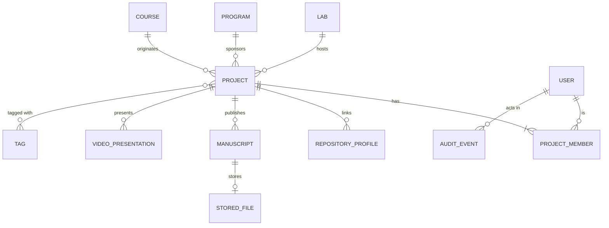

# spec.md — Project Artifact & Repository Indexer (PAI)

**Project Portal (PP) · Domain 1 · CS 763 Secure Software Development · Project Assignment 1**
**Author:** _<Alexa Stein>_ · **Version:** 1.0 (PA1) · **Stack:** Node.js 22 LTS · TypeScript 5 · Express 5 · PostgreSQL 16 · Prisma ORM

---

## AI Usage Log (mandatory)

| Field                      | Value                                                                                                                                                                                                                                    |
| -------------------------- | ---------------------------------------------------------------------------------------------------------------------------------------------------------------------------------------------------------------------------------------- |
| Conceptual AI contribution | **[__%] AI Generated / [__%] Human Authored** ← fill in after your own edits (a first draft written entirely by Claude starts at ~85% AI; lower it as you rewrite)                                                                       |
| Tool                       | Claude (claude.ai chat, model: Claude Opus 5.5) — conversational assistant, **not** the developer agent                                                                                                                                  |
| Design-aid prompts         | 1) "Please help me with the assignment [CS763 Project Assignment 1, Node.js/TypeScript, Claude Code] and give me detailed instructions" 2) "I think I have to do The Project Artifact & Repository Indexer since it's the only one left" |
| Chat link / export         | _<paste your claude.ai share link here>_                                                                                                                                                                                                 |
| Human review & changes     | _<list what you changed, e.g. "added DOI field", "renamed entities", "verified every endpoint against the ERD">_                                                                                                                         |

---

## 1. Purpose & Scope

PAI is the Project Portal backend service that **catalogs every artifact of an academic project** so it can be found, browsed and cited. For each project it manages:

- **Repository profiles** — metadata about public Git repositories (host, owner, name, default branch, primary language, license, stars, last commit), refreshed from a static mock of the Git host API.
- **Manuscripts** — academic documents (papers, theses, reports, posters) with bibliographic metadata and an uploaded PDF file.
- **Video presentations** — metadata about recorded talks and demos (hosting URL, duration, captions, thumbnail).

Every project and artifact is **classified by affiliation**: academic **lab**, department **program**, and **course** offering. The service provides faceted search across all artifacts.

**In scope:** project records, the three artifact types, affiliation taxonomy (read from mocks), faceted search, visibility (draft/public/archived), manuscript file upload & download, repository metadata refresh from the mock, audit trail.

**Out of scope (served by mocks, per the course isolation rule):** user directory/identity provider, real GitHub/GitLab API calls, video hosting, grading (Domain 3), discussion (Domain 4), license/credit distribution (Domain 2). PAI **never calls another student's service or a real external API**; all external data comes from static files in `mock-data/` loaded at startup.

---

## 2. Actors & Roles

| Role          | Description                                     | Key capabilities                                                                           |
| ------------- | ----------------------------------------------- | ------------------------------------------------------------------------------------------ |
| `ADMIN`       | Portal operator                                 | Manage taxonomy mirror, any project, audit log                                             |
| `CURATOR`     | Lab director / program coordinator / instructor | Create projects in their lab/program/course, feature or archive any project in their scope |
| `CONTRIBUTOR` | Student or researcher on a project team         | Create/edit artifacts of projects they belong to, submit project for publication           |
| `VIEWER`      | Anyone (incl. unauthenticated)                  | Browse and search **PUBLIC** projects and artifacts, download public manuscripts           |

> Identity in Phase 1/2 is simulated with a mock header `X-Mock-User-Id` resolved against `mock-data/users.json`. Phase 3 replaces this with local JWT (asymmetric RS256/EdDSA) verification middleware. Authorization rules are listed in §8 as **requirements** so the threat model (PA2) and secure refactor (PA3) can test against them.

---

## 3. Domain Model

### 3.1 Entity Relationship Diagram



`USER`, `LAB`, `PROGRAM` and `COURSE` are **read-only mock entities** (loaded from JSON, mirrored into reference tables for FK integrity). Everything else is owned and persisted by PAI in PostgreSQL.

### 3.2 Tables

All IDs are UUID v4 unless noted. All tables have `created_at timestamptz default now()` and `updated_at timestamptz`.

**`project`**
| Column | Type | Constraints |
|---|---|---|
| id | uuid | PK |
| slug | varchar(80) | UNIQUE, `^[a-z0-9-]+$` |
| title | varchar(200) | NOT NULL |
| abstract | text | ≤ 5,000 chars |
| lab_id | text | FK → lab.id, nullable |
| program_id | text | FK → program.id, NOT NULL |
| course_id | text | FK → course.id, nullable |
| project_type | enum(`CAPSTONE`,`RESEARCH`,`COURSE_PROJECT`,`THESIS`,`INDEPENDENT`) | NOT NULL |
| academic_term | varchar(20) | e.g. `2026FALL2` |
| visibility | enum(`DRAFT`,`PUBLIC`,`ARCHIVED`) | default `DRAFT` |
| featured | boolean | default false (curators only) |
| published_at | timestamptz | set on first DRAFT→PUBLIC |
| created_by | text | FK → user.id |

CHECK: at least one of `lab_id` or `course_id` is set.

**`project_member`**
| Column | Type | Constraints |
|---|---|---|
| project_id | uuid | FK → project.id ON DELETE CASCADE |
| user_id | text | FK → user.id |
| member_role | enum(`OWNER`,`CONTRIBUTOR`,`ADVISOR`) | NOT NULL |
| | | PK(project_id, user_id) |

**`repository_profile`**
| Column | Type | Constraints |
|---|---|---|
| id | uuid | PK |
| project_id | uuid | FK → project.id ON DELETE CASCADE |
| host | enum(`GITHUB`,`GITLAB`,`BITBUCKET`) | NOT NULL |
| owner | varchar(100) | NOT NULL |
| name | varchar(100) | NOT NULL |
| url | varchar(300) | canonical `https://<host>/<owner>/<name>` (derived, not user-supplied) |
| default_branch | varchar(100) | from mock |
| primary_language | varchar(50) | from mock |
| license_spdx | varchar(50) | from mock, e.g. `MIT` |
| stars | int | from mock |
| last_commit_at | timestamptz | from mock |
| sync_status | enum(`PENDING`,`SYNCED`,`NOT_FOUND`) | default `PENDING` |
| last_synced_at | timestamptz | |
| | | UNIQUE(host, owner, name, project_id) |

**`manuscript`**
| Column | Type | Constraints |
|---|---|---|
| id | uuid | PK |
| project_id | uuid | FK → project.id ON DELETE CASCADE |
| title | varchar(300) | NOT NULL |
| manuscript_type | enum(`PAPER`,`THESIS`,`TECH_REPORT`,`POSTER`,`PREPRINT`) | NOT NULL |
| authors | jsonb | ordered array `[{name, userId?, orcid?}]`, 1–50 items |
| abstract | text | ≤ 5,000 chars |
| venue | varchar(200) | journal/conference |
| doi | varchar(100) | optional, `^10\.\d{4,9}/\S+$` |
| publication_date | date | |
| keywords | text[] | ≤ 15 items |
| file_id | uuid | FK → stored_file.id, nullable |
| visibility | enum(`INHERIT`,`PRIVATE`) | default `INHERIT` (follows project) |

**`stored_file`**
| Column | Type | Constraints |
|---|---|---|
| id | uuid | PK |
| original_name | varchar(255) | as uploaded (display only) |
| storage_key | varchar(100) | server-generated `<uuid>.pdf`, never derived from user input |
| mime_type | varchar(100) | `application/pdf` only |
| size_bytes | int | ≤ 25 MB |
| sha256 | char(64) | integrity checksum |
| uploaded_by | text | FK → user.id |

Files live on a local volume (`/data/files`) inside the single-tenant deployment.

**`video_presentation`**
| Column | Type | Constraints |
|---|---|---|
| id | uuid | PK |
| project_id | uuid | FK → project.id ON DELETE CASCADE |
| title | varchar(200) | NOT NULL |
| platform | enum(`YOUTUBE`,`VIMEO`,`KALTURA`,`OTHER`) | NOT NULL |
| video_url | varchar(500) | https only |
| duration_sec | int | 1–36,000 |
| recorded_at | date | |
| event_name | varchar(200) | e.g. "CS763 Demo Day" |
| presenters | text[] | display names |
| captions_available | boolean | default false |
| thumbnail_url | varchar(500) | https only, optional |

**`tag`** — `id serial PK, label varchar(40) UNIQUE lowercase`; **`project_tag`** — `PK(project_id, tag_id)`.

**`audit_event`** (append-only)
| Column | Type | Constraints |
|---|---|---|
| id | bigserial | PK |
| actor_id | text | |
| action | varchar(64) | e.g. `PROJECT_PUBLISHED`, `MANUSCRIPT_FILE_UPLOADED` |
| entity_type | varchar(40) | |
| entity_id | text | |
| before | jsonb | |
| after | jsonb | |
| ip | inet | |
| at | timestamptz | default now() |

**Reference (mock-mirrored) tables:** `user(id, display_name, email, role, department)`, `lab(id, name, department, director_id)`, `program(id, code, name, department, coordinator_id)`, `course(id, code, title, term, program_id, instructor_ids text[])`.

---

## 4. Lifecycles

**Project visibility:** `DRAFT → PUBLIC → ARCHIVED`, and `PUBLIC → DRAFT` (unpublish) by owner or curator. `ARCHIVED` projects stay readable via direct link but are excluded from search unless `?includeArchived=true`.

**Repository sync:** `PENDING → SYNCED` when the `(host, owner, name)` exists in `mock-data/git-host-repos.json`, else `NOT_FOUND`. Re-sync can be requested at any time.

**Publish rule:** a project can go `PUBLIC` only if it has a title, an abstract, at least one OWNER and at least one artifact (repository, manuscript, or video).

---

## 5. REST API

- Base path: `/api/v1` · JSON (`application/json`) except file upload (`multipart/form-data`) and download (`application/pdf`) · UTF-8
- Pagination: `?page=1&pageSize=20` (max 100) → `{ "data": [...], "page": 1, "pageSize": 20, "total": 57 }`
- Sorting: `?sort=-publishedAt` (allowed: `title`, `publishedAt`, `updatedAt`, `stars`)
- Errors: RFC 9457 Problem Details (`application/problem+json`)
  ```json
  {
    "type": "https://pai.local/errors/validation",
    "title": "Validation failed",
    "status": 422,
    "detail": "doi does not match the DOI pattern",
    "instance": "/api/v1/projects/7d2.../manuscripts",
    "errors": [{ "path": "doi", "message": "must match ^10\\.\\d{4,9}/\\S+$" }]
  }
  ```

### 5.1 Endpoint catalog

| #   | Method | Path                                        | Allowed roles                             | Description                                                                                                     |
| --- | ------ | ------------------------------------------- | ----------------------------------------- | --------------------------------------------------------------------------------------------------------------- |
| 1   | GET    | `/health`                                   | public                                    | Liveness `{status:"ok", version, uptimeSec}`                                                                    |
| 2   | GET    | `/ready`                                    | public                                    | Readiness incl. DB ping and mock data loaded                                                                    |
| 3   | GET    | `/api/v1/catalog/labs`                      | public                                    | List labs (mock)                                                                                                |
| 4   | GET    | `/api/v1/catalog/programs`                  | public                                    | List programs (mock)                                                                                            |
| 5   | GET    | `/api/v1/catalog/courses`                   | public                                    | List courses (mock), `?programId=&term=`                                                                        |
| 6   | POST   | `/api/v1/projects`                          | CURATOR, CONTRIBUTOR                      | Create project (DRAFT); creator becomes OWNER                                                                   |
| 7   | GET    | `/api/v1/projects`                          | any                                       | List/filter projects: `?labId=&programId=&courseId=&type=&term=&tag=&visibility=` (non-members see PUBLIC only) |
| 8   | GET    | `/api/v1/projects/{projectIdOrSlug}`        | any (PUBLIC) / members & curators (DRAFT) | Project with artifact summary                                                                                   |
| 9   | PATCH  | `/api/v1/projects/{projectId}`              | OWNER, CURATOR                            | Update metadata, affiliations, tags                                                                             |
| 10  | DELETE | `/api/v1/projects/{projectId}`              | OWNER (DRAFT only), ADMIN                 | Delete                                                                                                          |
| 11  | POST   | `/api/v1/projects/{projectId}/publish`      | OWNER, CURATOR                            | DRAFT → PUBLIC (publish rule §4)                                                                                |
| 12  | POST   | `/api/v1/projects/{projectId}/unpublish`    | OWNER, CURATOR                            | PUBLIC → DRAFT                                                                                                  |
| 13  | POST   | `/api/v1/projects/{projectId}/archive`      | CURATOR, ADMIN                            | → ARCHIVED                                                                                                      |
| 14  | PUT    | `/api/v1/projects/{projectId}/members`      | OWNER                                     | Replace member list                                                                                             |
| 15  | POST   | `/api/v1/projects/{projectId}/repositories` | members                                   | Link a repository profile (host/owner/name), triggers mock sync                                                 |
| 16  | GET    | `/api/v1/projects/{projectId}/repositories` | per project visibility                    | List repository profiles                                                                                        |
| 17  | POST   | `/api/v1/repositories/{repoId}/sync`        | members                                   | Re-sync metadata from the mock Git host                                                                         |
| 18  | DELETE | `/api/v1/repositories/{repoId}`             | members                                   | Unlink                                                                                                          |
| 19  | POST   | `/api/v1/projects/{projectId}/manuscripts`  | members                                   | Create manuscript metadata                                                                                      |
| 20  | GET    | `/api/v1/projects/{projectId}/manuscripts`  | per visibility                            | List manuscripts                                                                                                |
| 21  | PATCH  | `/api/v1/manuscripts/{manuscriptId}`        | members                                   | Update metadata                                                                                                 |
| 22  | PUT    | `/api/v1/manuscripts/{manuscriptId}/file`   | members                                   | Upload/replace PDF (`multipart/form-data`, field `file`)                                                        |
| 23  | GET    | `/api/v1/manuscripts/{manuscriptId}/file`   | per visibility                            | Download PDF (`Content-Disposition: attachment`)                                                                |
| 24  | DELETE | `/api/v1/manuscripts/{manuscriptId}`        | members                                   | Delete manuscript and its file                                                                                  |
| 25  | POST   | `/api/v1/projects/{projectId}/videos`       | members                                   | Add video presentation metadata                                                                                 |
| 26  | GET    | `/api/v1/projects/{projectId}/videos`       | per visibility                            | List videos                                                                                                     |
| 27  | PATCH  | `/api/v1/videos/{videoId}`                  | members                                   | Update                                                                                                          |
| 28  | DELETE | `/api/v1/videos/{videoId}`                  | members                                   | Delete                                                                                                          |
| 29  | GET    | `/api/v1/search`                            | any                                       | Faceted search across all artifact types (see §5.3)                                                             |
| 30  | GET    | `/api/v1/stats`                             | public                                    | Counts by lab / program / course / artifact type                                                                |
| 31  | GET    | `/api/v1/audit`                             | ADMIN                                     | Query audit events (`?entityId=&action=`)                                                                       |

### 5.2 Key payload schemas (JSON Schema draft 2020-12, abbreviated)

**CreateProjectRequest** (endpoint 6)

```json
{
  "type": "object",
  "required": ["title", "programId", "projectType"],
  "additionalProperties": false,
  "properties": {
    "title": { "type": "string", "minLength": 3, "maxLength": 200 },
    "slug": { "type": "string", "pattern": "^[a-z0-9-]{3,80}$" },
    "abstract": { "type": "string", "maxLength": 5000 },
    "labId": { "type": "string" },
    "programId": { "type": "string" },
    "courseId": { "type": "string" },
    "projectType": {
      "enum": [
        "CAPSTONE",
        "RESEARCH",
        "COURSE_PROJECT",
        "THESIS",
        "INDEPENDENT"
      ]
    },
    "academicTerm": {
      "type": "string",
      "pattern": "^[0-9]{4}(SPRG|SUMR|FALL)[12]?$"
    },
    "tags": {
      "type": "array",
      "maxItems": 10,
      "items": { "type": "string", "pattern": "^[a-z0-9-]{2,40}$" }
    },
    "members": {
      "type": "array",
      "items": {
        "type": "object",
        "required": ["userId", "memberRole"],
        "properties": {
          "userId": { "type": "string" },
          "memberRole": { "enum": ["OWNER", "CONTRIBUTOR", "ADVISOR"] }
        }
      }
    }
  }
}
```

Example:

```json
{
  "title": "AI-Agent Secure Pipeline Study",
  "slug": "ai-agent-secure-pipeline",
  "abstract": "Measures how secure-by-design prompting changes vulnerabilities in agent-generated services.",
  "labId": "lab-sail",
  "programId": "prog-mscis",
  "courseId": "c-cs763-f26",
  "projectType": "COURSE_PROJECT",
  "academicTerm": "2026FALL2",
  "tags": ["devsecops", "llm-agents"],
  "members": [{ "userId": "u-stu-02", "memberRole": "CONTRIBUTOR" }]
}
```

**ProjectResponse** — request fields plus `id, visibility, featured, publishedAt, createdBy, createdAt, updatedAt, lab{id,name}, program{id,name}, course{id,code}, artifactCounts{repositories, manuscripts, videos}`.

**LinkRepositoryRequest** (endpoint 15)

```json
{ "host": "GITHUB", "owner": "bu-met-sail", "name": "agent-pipeline-study" }
```

`owner`/`name`: `^[A-Za-z0-9_.-]{1,100}$`. The server derives `url`; a client-supplied URL is not accepted. Response includes the mock-synced fields and `syncStatus`.

**CreateManuscriptRequest** (endpoint 19)

```json
{
  "title": "Prompt Guardrails vs. Autonomous Coding Agents",
  "manuscriptType": "TECH_REPORT",
  "authors": [
    { "name": "Leo Park", "userId": "u-stu-02" },
    { "name": "Dr. Ada Rivera", "orcid": "0000-0002-1825-0097" }
  ],
  "abstract": "…",
  "venue": "BU MET Technical Report Series",
  "doi": "10.5555/pai.2026.001",
  "publicationDate": "2026-12-10",
  "keywords": ["secure prompting", "SAST"]
}
```

**UploadManuscriptFile** (endpoint 22): `multipart/form-data`, single part `file`, PDF only (checked by magic bytes `%PDF-` as well as declared type), ≤ 25 MB. Response `{ fileId, originalName, sizeBytes, sha256 }`.

**CreateVideoRequest** (endpoint 25)

```json
{
  "title": "Demo Day Walkthrough",
  "platform": "YOUTUBE",
  "videoUrl": "https://www.youtube.com/watch?v=abc123XYZ",
  "durationSec": 612,
  "recordedAt": "2026-12-12",
  "eventName": "CS763 Demo Day",
  "presenters": ["Leo Park"],
  "captionsAvailable": true
}
```

`videoUrl` and `thumbnailUrl` must be `https://`; the service stores them but **never fetches them**.

### 5.3 Search (endpoint 29)

`GET /api/v1/search?q=<text>&type=repository,manuscript,video&labId=&programId=&courseId=&term=&language=&license=&from=2025-01-01&to=2026-12-31&page=1&pageSize=20`

- `q` matches project title/abstract, manuscript title/abstract/keywords/authors, video title/event, repository name/language (PostgreSQL full-text search, `websearch_to_tsquery`).
- Results are ranked and include facet counts:

```json
{
  "data": [
    {
      "artifactType": "manuscript",
      "id": "…",
      "title": "Prompt Guardrails vs. Autonomous Coding Agents",
      "project": {
        "id": "…",
        "slug": "ai-agent-secure-pipeline",
        "title": "AI-Agent Secure Pipeline Study"
      },
      "affiliations": {
        "lab": "Secure AI Lab",
        "program": "MS CIS",
        "course": "MET CS 763"
      },
      "score": 0.83
    }
  ],
  "facets": {
    "type": { "manuscript": 4, "repository": 7, "video": 2 },
    "lab": { "lab-sail": 9 },
    "program": { "prog-mscis": 11 }
  },
  "page": 1,
  "pageSize": 20,
  "total": 13
}
```

- Only PUBLIC projects (and their non-PRIVATE artifacts) appear for non-members.

### 5.4 HTTP status code use

`200` read/update · `201` create (with `Location`) · `204` delete · `400` malformed request · `401` no identity · `403` role denied · `404` not found **or not visible** (prefer 404 to avoid revealing DRAFT projects) · `409` state conflict / duplicate slug or repository · `413` file too large · `415` unsupported file type · `422` business validation · `429` rate limited.

---

## 6. Repository Sync from the Mock Git Host

`mock-data/git-host-repos.json` stands in for the GitHub/GitLab API. On link (#15) or sync (#17):

1. Look up `(host, owner.toLowerCase(), name.toLowerCase())` in the mock.
2. Found → copy `defaultBranch, primaryLanguage, licenseSpdx, stars, lastCommitAt`; `syncStatus = SYNCED`.
3. Not found → `syncStatus = NOT_FOUND`; the profile is kept so the user can correct it.
4. No network request is ever made.

---

## 7. Static Mock Data (`mock-data/`)

`users.json`

```json
[
  {
    "id": "u-adm-01",
    "displayName": "Portal Admin",
    "email": "admin@pp.example.edu",
    "role": "ADMIN",
    "department": "IT"
  },
  {
    "id": "u-cur-01",
    "displayName": "Dr. Ada Rivera",
    "email": "arivera@pp.example.edu",
    "role": "CURATOR",
    "department": "CS"
  },
  {
    "id": "u-cur-02",
    "displayName": "Prof. Ken Okafor",
    "email": "kokafor@pp.example.edu",
    "role": "CURATOR",
    "department": "CS"
  },
  {
    "id": "u-stu-01",
    "displayName": "Mia Chen",
    "email": "mchen@pp.example.edu",
    "role": "CONTRIBUTOR",
    "department": "CS"
  },
  {
    "id": "u-stu-02",
    "displayName": "Leo Park",
    "email": "lpark@pp.example.edu",
    "role": "CONTRIBUTOR",
    "department": "CS"
  },
  {
    "id": "u-stu-03",
    "displayName": "Sara Haddad",
    "email": "shaddad@pp.example.edu",
    "role": "CONTRIBUTOR",
    "department": "CS"
  }
]
```

`labs.json`

```json
[
  {
    "id": "lab-sail",
    "name": "Secure AI Lab",
    "department": "CS",
    "directorId": "u-cur-01"
  },
  {
    "id": "lab-hci",
    "name": "Human-Computer Interaction Lab",
    "department": "CS",
    "directorId": "u-cur-02"
  }
]
```

`programs.json`

```json
[
  {
    "id": "prog-mscis",
    "code": "MSCIS",
    "name": "MS in Computer Information Systems",
    "department": "CS",
    "coordinatorId": "u-cur-02"
  },
  {
    "id": "prog-msse",
    "code": "MSSD",
    "name": "MS in Software Development",
    "department": "CS",
    "coordinatorId": "u-cur-02"
  }
]
```

`courses.json`

```json
[
  {
    "id": "c-cs763-f26",
    "code": "MET CS 763",
    "title": "Secure Software Development",
    "term": "2026FALL2",
    "programId": "prog-mscis",
    "instructorIds": ["u-cur-01"]
  },
  {
    "id": "c-cs673-f26",
    "code": "MET CS 673",
    "title": "Software Engineering",
    "term": "2026FALL1",
    "programId": "prog-msse",
    "instructorIds": ["u-cur-02"]
  }
]
```

`git-host-repos.json`

```json
[
  {
    "host": "GITHUB",
    "owner": "bu-met-sail",
    "name": "agent-pipeline-study",
    "defaultBranch": "main",
    "primaryLanguage": "TypeScript",
    "licenseSpdx": "MIT",
    "stars": 42,
    "lastCommitAt": "2026-10-30T18:22:00Z"
  },
  {
    "host": "GITHUB",
    "owner": "mchen-bu",
    "name": "campus-ar-navigator",
    "defaultBranch": "main",
    "primaryLanguage": "Kotlin",
    "licenseSpdx": "Apache-2.0",
    "stars": 7,
    "lastCommitAt": "2026-09-14T09:05:00Z"
  },
  {
    "host": "GITLAB",
    "owner": "hci-lab",
    "name": "eye-tracking-toolkit",
    "defaultBranch": "develop",
    "primaryLanguage": "Python",
    "licenseSpdx": "BSD-3-Clause",
    "stars": 15,
    "lastCommitAt": "2026-08-02T12:00:00Z"
  }
]
```

`seed-projects.json` — the example project from §5.2 (owner `u-stu-01`), used to seed a fresh database.

---

## 8. Authorization Requirements (to be enforced from Phase 3)

| ID   | Rule                                                                                                                               |
| ---- | ---------------------------------------------------------------------------------------------------------------------------------- |
| AZ-1 | DRAFT projects and PRIVATE manuscripts are visible only to project members, curators in scope, and admins.                         |
| AZ-2 | Artifacts can be created, changed or deleted only by members of the owning project (row-level check on `project_member`).          |
| AZ-3 | Curators may act only on projects whose `lab_id` they direct, whose `program_id` they coordinate, or whose `course_id` they teach. |
| AZ-4 | Only OWNERs change membership; a project must always keep ≥ 1 OWNER.                                                               |
| AZ-5 | `featured` and `archive` are curator/admin-only fields/actions.                                                                    |
| AZ-6 | Manuscript downloads enforce the same visibility as metadata reads.                                                                |
| AZ-7 | Every publish, unpublish, archive, delete, membership change and file upload writes an `audit_event`.                              |

## 9. Architecture & Deployment

```
Client ──HTTPS──> [ pai-api (Express 5, Node 22, non-root container) ] ──TCP 5432──> [ pai-db (PostgreSQL 16) ]
                         │
                         ├── /data/files (local volume, manuscript PDFs)
                         └── ./mock-data/*.json (read-only, loaded at boot)
```

- Layers: `routes → controllers → services → repositories (Prisma) → DB`; `storage` module for files.
- Config via env vars only (`DATABASE_URL`, `PORT`, `FILE_STORAGE_DIR`, `MAX_UPLOAD_MB`, later `JWT_PUBLIC_KEY_PATH`). No secrets in images or repo.
- Single-tenant: one DB and one file volume per deployment; no calls to other PP services or real Git hosts.
- Observability: structured JSON logs, request id header `X-Request-Id`.

## 10. Non-Functional Requirements

| ID    | Requirement                                                                                                                                              |
| ----- | -------------------------------------------------------------------------------------------------------------------------------------------------------- |
| NFR-1 | p95 latency < 300 ms for single-entity reads; search p95 < 800 ms over 50k artifacts.                                                                    |
| NFR-2 | Upload up to 25 MB PDF streams to disk (no full in-memory buffering).                                                                                    |
| NFR-3 | Multi-row writes (create project + members + tags) are transactional.                                                                                    |
| NFR-4 | Container runs as non-root; root FS read-only except `/data/files` and `/tmp`.                                                                           |
| NFR-5 | ≥ 80% unit test line coverage on `services/` by Phase 3.                                                                                                 |
| NFR-6 | Unpublished research (DRAFT projects, PRIVATE manuscripts) must not leak — confidentiality and integrity of the catalog are the top security objectives. |

## 11. Security-Relevant Assets & Entry Points (input for PA2 threat model)

**Assets:** unpublished manuscripts and DRAFT project metadata · uploaded PDF files and the storage volume · catalog integrity (who owns what, what is featured) · audit log · DB credentials · (Phase 3) JWT signing keys.
**High-risk entry points:** file upload/download (#22, #23), free-text search (#29), stored URLs rendered by portal UIs (#25), slug/ID lookups (#8), membership changes (#14).

## 12. Glossary

**Artifact** – a repository profile, manuscript, or video belonging to a project; **Affiliation** – the lab/program/course a project belongs to; **Sync** – copying repository metadata from the mock Git host; **Publish** – making a project visible to everyone.
